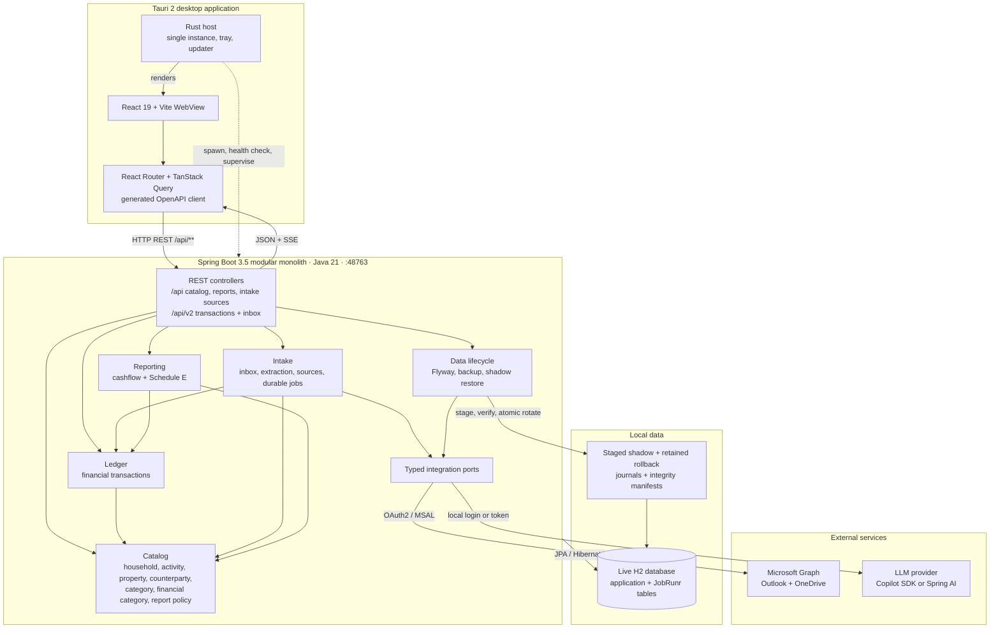
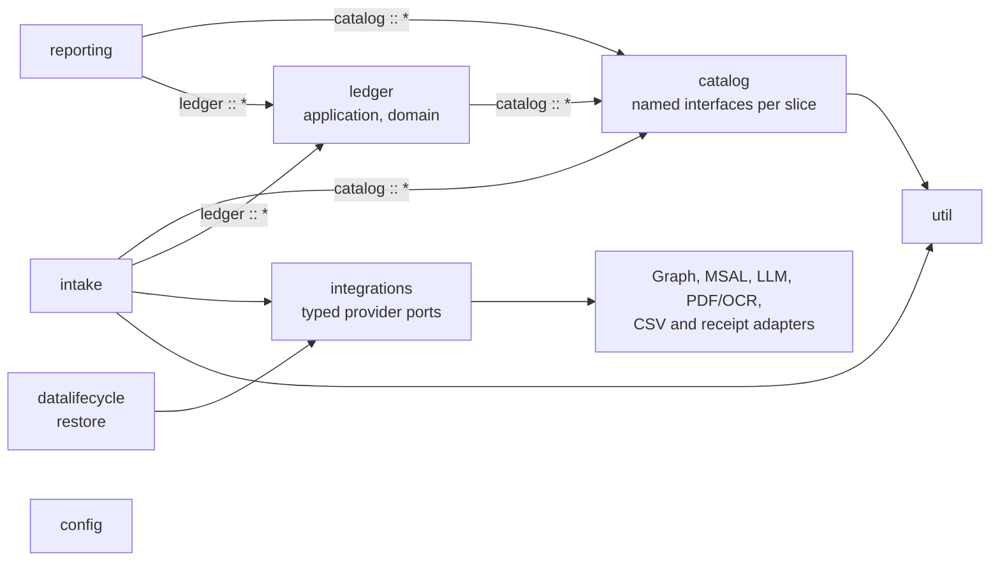
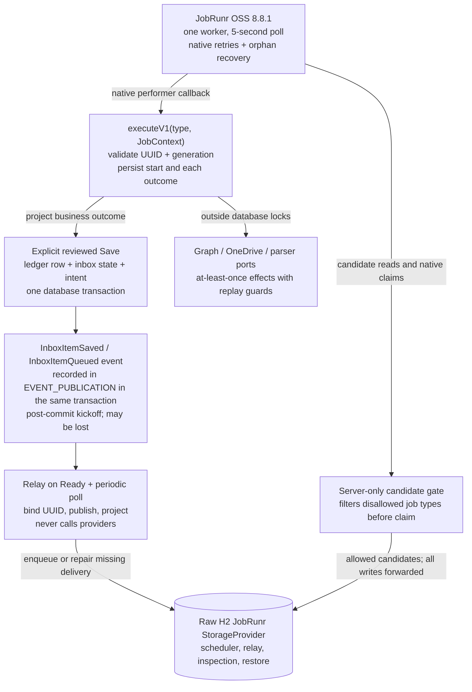

# Bookie Architecture Diagrams

These Mermaid diagrams show the runtime topology, modular-monolith boundaries, and durable intake
execution model. Generated PNG previews are included for Markdown viewers that do not execute
Mermaid, including IntelliJ installations without Mermaid support. See
[`../ARCHITECTURE.md`](../ARCHITECTURE.md) for the detailed contracts. The PNG previews may lag the
Mermaid source; the source is authoritative.

## Runtime Architecture

Mermaid source

In development, Vite serves the UI on port `5173` and proxies `/api` to port `48763`. In packaged
builds, Tauri serves the frontend assets, owns the backend process, waits for readiness before
showing the window, and performs bounded restart supervision.

## Module Dependencies

Mermaid source

The arrows are the `@ApplicationModule(allowedDependencies = …)` declarations; `module :: *`
admits only that module's named interfaces. `config` and `util` depend on no other module, and
provider SDK types remain inside integration adapters.

## Durable Intake Execution

Mermaid source

Disallowed work remains in its real JobRunr state without consuming retries. The raw provider stays
visible to publication, inspection, and restore; only the worker server receives the candidate
filter. Remote effects are at-least-once and rely on immutable identity, checksum, destination-year,
and idempotency guards.
