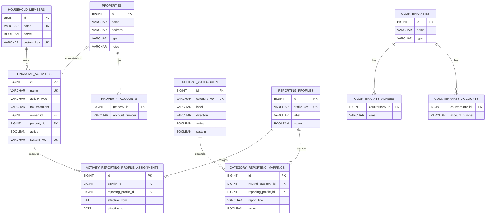
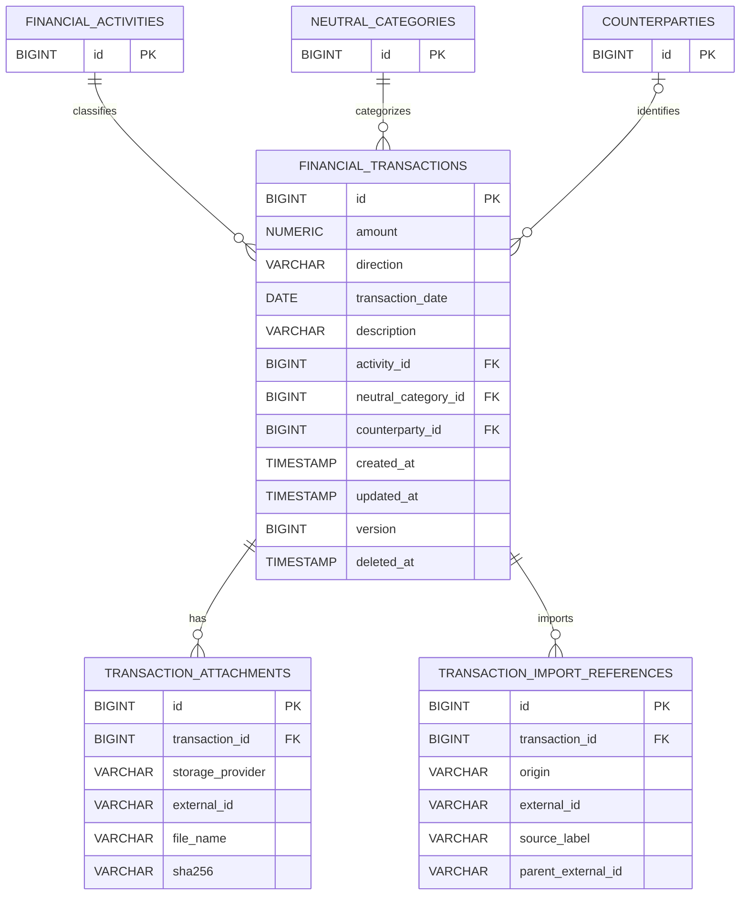
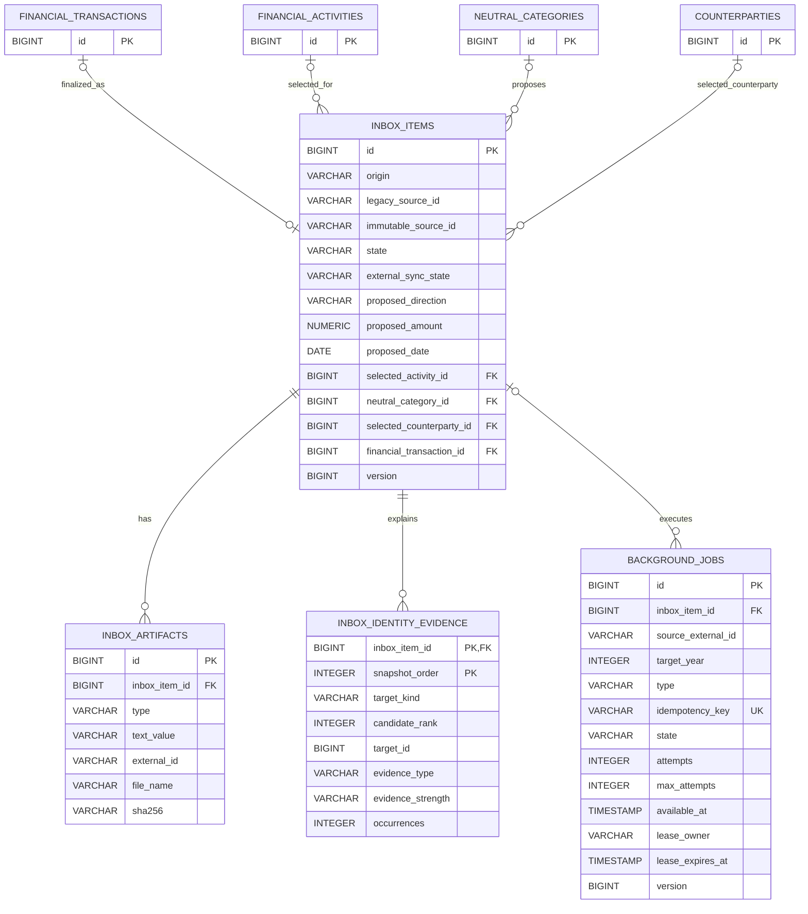

# Bookie Entity-Relationship Diagrams

The schema is split into bounded views so the Mermaid diagrams remain readable. These diagrams show
application-owned tables and their important columns and relationships as of Flyway V25 (V20 retired
the legacy expense, income, pending and payer-mirror tables; V25 retired `financial_categories`,
`legacy_category_map`, legacy category-history tables, and the embedded JobRunr tables). Generated
PNG previews are included for Markdown viewers that do not execute Mermaid.

## Catalog and Report Policy

Mermaid source

V20 renamed `payers`, `payer_aliases` and `payer_accounts` to `counterparties`,
`counterparty_aliases` and `counterparty_accounts` (column `payer_id` → `counterparty_id`) after
dropping the V12 mirror, so counterparty IDs and native identity generation are unchanged. V25
retired `financial_categories` and `legacy_category_map` so `neutral_categories` and
`category_reporting_mappings` are the sole category and report-line tables.

## Unified Ledger

Mermaid source

`financial_transactions` is the only financial record table. Deletes tombstone the row
(`deleted_at`). Historically, V13 copied the legacy `incomes` and `expenses` rows into it through
`legacy_transaction_map`; V20 verified exact parity and dropped all three.

## Durable Intake

Mermaid source

`inbox_items` is the only intake table. `neutral_category_id` references `neutral_categories` and
`selected_counterparty_id` references `counterparties`. `background_jobs` is the single durable
outbox table: each job references either `inbox_item_id` or `source_external_id` (enforced by
`ck_background_jobs_subject`), and active claims stamp `lease_owner` and `lease_expires_at`. V22
dropped the V21 `EVENT_PUBLICATION` registry, and V25 dropped `background_jobs.execution_*` and the
`jobrunr_*` tables.

## Classification and Integration Settings

```mermaid
erDiagram
  PROPERTIES {
    BIGINT id PK
  }

  COUNTERPARTIES {
    BIGINT id PK
  }

  FINANCIAL_ACTIVITIES {
    BIGINT id PK
  }

  NEUTRAL_CATEGORIES {
    BIGINT id PK
  }

  OUTLOOK_SETTINGS {
    BIGINT id PK
    VARCHAR receipts_folder_base
    BOOLEAN auto_move_enabled
    VARCHAR move_destination_folder_id
  }

  OUTLOOK_SETTINGS_FOLDER {
    BIGINT settings_id FK
    VARCHAR folder_id
    BOOLEAN expand_subfolders
    BIGINT activity_id FK
  }

  OUTLOOK_SETTINGS_RECEIPTS_IMPORT_FOLDER {
    BIGINT settings_id FK
    VARCHAR folder_path
  }

  OUTLOOK_TOKENS {
    BIGINT id PK
    VARCHAR cache_data
  }

  RECEIPT_HASHES {
    BIGINT id PK
    VARCHAR drive_item_id
    VARCHAR sha256 UK
    TIMESTAMP uploaded_at
  }

  EMAIL_KEYWORD_CLASSIFICATION_HISTORY {
    BIGINT id PK
    VARCHAR keyword
    BIGINT activity_id FK
    BIGINT neutral_category_id FK
    INTEGER occurrences
    BIGINT version
  }

  PAYER_PROPERTY_HISTORY {
    BIGINT id PK
    BIGINT payer_id FK
    BIGINT property_id FK
    INTEGER occurrences
  }

  EMAIL_KEYWORD_PROPERTY_HISTORY {
    BIGINT id PK
    VARCHAR keyword
    BIGINT property_id FK
    INTEGER occurrences
  }

  EMAIL_KEYWORD_PAYER_HISTORY {
    BIGINT id PK
    VARCHAR keyword
    BIGINT payer_id FK
    INTEGER occurrences
  }

  OUTLOOK_SETTINGS ||--o{ OUTLOOK_SETTINGS_FOLDER : watches
  OUTLOOK_SETTINGS ||--o{ OUTLOOK_SETTINGS_RECEIPTS_IMPORT_FOLDER : scans
  FINANCIAL_ACTIVITIES o|--o{ OUTLOOK_SETTINGS_FOLDER : configures
  FINANCIAL_ACTIVITIES ||--o{ EMAIL_KEYWORD_CLASSIFICATION_HISTORY : learned_for
  NEUTRAL_CATEGORIES ||--o{ EMAIL_KEYWORD_CLASSIFICATION_HISTORY : categorizes
  COUNTERPARTIES ||--o{ PAYER_PROPERTY_HISTORY : associates
  PROPERTIES ||--o{ PAYER_PROPERTY_HISTORY : associates
  PROPERTIES ||--o{ EMAIL_KEYWORD_PROPERTY_HISTORY : inferred_from
  COUNTERPARTIES ||--o{ EMAIL_KEYWORD_PAYER_HISTORY : inferred_from
```

Mermaid source

The history tables keep their `payer_*` table and column names, but their foreign keys follow the
renamed `counterparties` table. V25 retired `payer_category_history` and
`email_keyword_category_history` and migrated `email_keyword_classification_history` directly to
`neutral_category_id`. `outlook_tokens` and `receipt_hashes` stand alone because their identities
belong to external systems rather than another local table.
