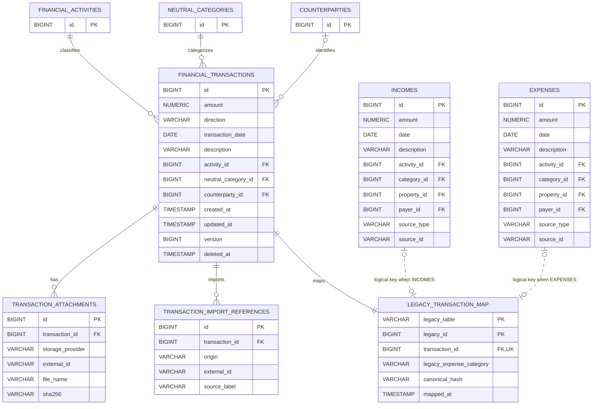
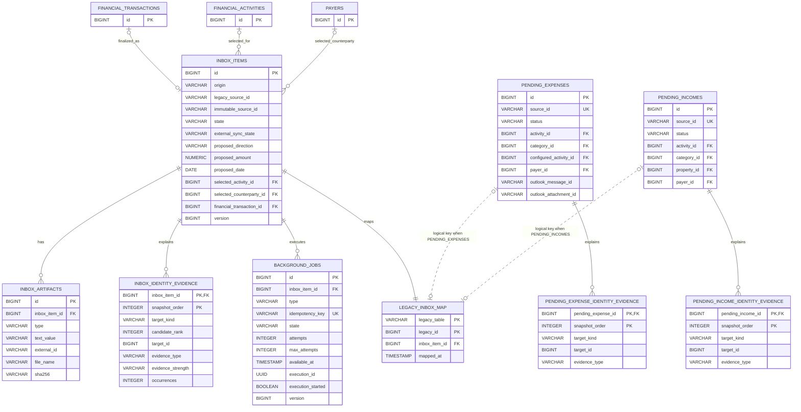

# Bookie Entity-Relationship Diagrams

The schema is split into bounded views so the Mermaid diagrams remain readable. These diagrams show
application-owned tables and their important columns and relationships as of Flyway V18. Generated
PNG previews are included for Markdown viewers that do not execute Mermaid. JobRunr's vendor-owned
tables are summarized separately because they have no foreign keys into Bookie's business schema.

## Catalog and Report Policy

```mermaid
erDiagram
  HOUSEHOLD_MEMBERS {
    BIGINT id PK
    VARCHAR name UK
    BOOLEAN active
    VARCHAR system_key UK
  }

  PROPERTIES {
    BIGINT id PK
    VARCHAR name
    VARCHAR address
    VARCHAR type
    VARCHAR notes
  }

  PROPERTY_ACCOUNTS {
    BIGINT property_id FK
    VARCHAR account_number
  }

  FINANCIAL_ACTIVITIES {
    BIGINT id PK
    VARCHAR name UK
    VARCHAR activity_type
    VARCHAR tax_treatment
    BIGINT owner_id FK
    BIGINT property_id FK
    BOOLEAN active
    VARCHAR system_key UK
  }

  FINANCIAL_CATEGORIES {
    BIGINT id PK
    VARCHAR category_key UK
    VARCHAR label
    VARCHAR direction
    VARCHAR tax_treatment
    VARCHAR tax_line
    BOOLEAN active
    BOOLEAN system
  }

  NEUTRAL_CATEGORIES {
    BIGINT id PK
    VARCHAR category_key UK
    VARCHAR label
    VARCHAR direction
    BOOLEAN active
    BOOLEAN system
  }

  LEGACY_CATEGORY_MAP {
    BIGINT legacy_category_id PK,FK
    BIGINT neutral_category_id FK
    VARCHAR legacy_category_key UK
  }

  REPORTING_PROFILES {
    BIGINT id PK
    VARCHAR profile_key UK
    VARCHAR label
    BOOLEAN active
  }

  ACTIVITY_REPORTING_PROFILE_ASSIGNMENTS {
    BIGINT id PK
    BIGINT activity_id FK
    BIGINT reporting_profile_id FK
    DATE effective_from
    DATE effective_to
  }

  CATEGORY_REPORTING_MAPPINGS {
    BIGINT id PK
    BIGINT neutral_category_id FK
    BIGINT reporting_profile_id FK
    BIGINT legacy_category_id FK
    VARCHAR report_line
    BOOLEAN active
  }

  PAYERS {
    BIGINT id PK
    VARCHAR name
    VARCHAR type
  }

  PAYER_ALIASES {
    BIGINT payer_id FK
    VARCHAR alias
  }

  PAYER_ACCOUNTS {
    BIGINT payer_id FK
    VARCHAR account_number
  }

  COUNTERPARTIES {
    BIGINT id PK
    VARCHAR name
    VARCHAR type
  }

  COUNTERPARTY_ALIASES {
    BIGINT counterparty_id FK
    VARCHAR alias
  }

  COUNTERPARTY_ACCOUNTS {
    BIGINT counterparty_id FK
    VARCHAR account_number
  }

  LEGACY_PAYER_MAP {
    BIGINT payer_id PK,FK
    BIGINT counterparty_id FK,UK
  }

  HOUSEHOLD_MEMBERS ||--o{ FINANCIAL_ACTIVITIES : owns
  PROPERTIES o|--o| FINANCIAL_ACTIVITIES : contextualizes
  PROPERTIES ||--o{ PROPERTY_ACCOUNTS : has
  FINANCIAL_ACTIVITIES ||--o{ ACTIVITY_REPORTING_PROFILE_ASSIGNMENTS : receives
  REPORTING_PROFILES ||--o{ ACTIVITY_REPORTING_PROFILE_ASSIGNMENTS : assigns
  FINANCIAL_CATEGORIES ||--|| LEGACY_CATEGORY_MAP : maps
  NEUTRAL_CATEGORIES ||--o{ LEGACY_CATEGORY_MAP : receives
  NEUTRAL_CATEGORIES ||--o{ CATEGORY_REPORTING_MAPPINGS : classifies
  REPORTING_PROFILES ||--o{ CATEGORY_REPORTING_MAPPINGS : scopes
  FINANCIAL_CATEGORIES ||--|| CATEGORY_REPORTING_MAPPINGS : preserves
  PAYERS ||--o{ PAYER_ALIASES : has
  PAYERS ||--o{ PAYER_ACCOUNTS : has
  COUNTERPARTIES ||--o{ COUNTERPARTY_ALIASES : has
  COUNTERPARTIES ||--o{ COUNTERPARTY_ACCOUNTS : has
  PAYERS ||--|| LEGACY_PAYER_MAP : legacy
  COUNTERPARTIES ||--|| LEGACY_PAYER_MAP : normalized
```

Mermaid source

`payers` and `financial_categories` remain compatibility tables. Their normalized counterparts are
mirrored in the same transaction while legacy endpoints and rollback support remain active.

## Unified Ledger and Legacy Compatibility

Mermaid source

The dotted relationships are polymorphic logical keys, not database foreign keys. Every active
unified transaction has exactly one durable map to either `incomes` or `expenses`. Unified deletes
remove the legacy row and tombstone `financial_transactions`; compatibility writes update both
representations in one transaction.

Legacy `incomes` and `expenses` also have foreign keys to `financial_activities`,
`financial_categories`, `properties`, and `payers`. They are abbreviated above to keep the
dual-write relationship central.

## Durable Intake

Mermaid source

`legacy_inbox_map` uses a polymorphic logical key, shown with dotted relationships. Several
`inbox_items` legacy and confirmation ID columns intentionally preserve compatibility snapshots but
are not foreign keys. `selected_counterparty_id` currently references legacy `payers`, matching the
compatibility save path.

`background_jobs.execution_id` is a logical UUID binding to JobRunr's `jobrunr_jobs.id`; vendor
retention may remove the engine row, so no foreign key exists. JobRunr also owns
`jobrunr_migrations`, `jobrunr_recurring_jobs`, `jobrunr_backgroundjobservers`, and
`jobrunr_metadata`.

## Classification and Integration Settings

```mermaid
erDiagram
  PROPERTIES {
    BIGINT id PK
  }

  PAYERS {
    BIGINT id PK
  }

  FINANCIAL_ACTIVITIES {
    BIGINT id PK
  }

  FINANCIAL_CATEGORIES {
    BIGINT id PK
  }

  OUTLOOK_SETTINGS {
    BIGINT id PK
    VARCHAR receipts_folder_base
    BOOLEAN auto_move_enabled
    VARCHAR move_destination_folder_id
  }

  OUTLOOK_SETTINGS_FOLDER {
    BIGINT settings_id FK
    VARCHAR folder_id
    BOOLEAN expand_subfolders
    BIGINT activity_id FK
  }

  OUTLOOK_SETTINGS_RECEIPTS_IMPORT_FOLDER {
    BIGINT settings_id FK
    VARCHAR folder_path
  }

  OUTLOOK_TOKENS {
    BIGINT id PK
    VARCHAR cache_data
  }

  RECEIPT_HASHES {
    BIGINT id PK
    VARCHAR drive_item_id
    VARCHAR sha256 UK
    TIMESTAMP uploaded_at
  }

  EMAIL_KEYWORD_CLASSIFICATION_HISTORY {
    BIGINT id PK
    VARCHAR keyword
    BIGINT activity_id FK
    BIGINT financial_category_id FK
    INTEGER occurrences
    BIGINT version
  }

  PAYER_PROPERTY_HISTORY {
    BIGINT id PK
    BIGINT payer_id FK
    BIGINT property_id FK
    INTEGER occurrences
  }

  EMAIL_KEYWORD_PROPERTY_HISTORY {
    BIGINT id PK
    VARCHAR keyword
    BIGINT property_id FK
    INTEGER occurrences
  }

  EMAIL_KEYWORD_PAYER_HISTORY {
    BIGINT id PK
    VARCHAR keyword
    BIGINT payer_id FK
    INTEGER occurrences
  }

  OUTLOOK_SETTINGS ||--o{ OUTLOOK_SETTINGS_FOLDER : watches
  OUTLOOK_SETTINGS ||--o{ OUTLOOK_SETTINGS_RECEIPTS_IMPORT_FOLDER : scans
  FINANCIAL_ACTIVITIES o|--o{ OUTLOOK_SETTINGS_FOLDER : configures
  FINANCIAL_ACTIVITIES ||--o{ EMAIL_KEYWORD_CLASSIFICATION_HISTORY : learned_for
  FINANCIAL_CATEGORIES ||--o{ EMAIL_KEYWORD_CLASSIFICATION_HISTORY : categorizes
  PAYERS ||--o{ PAYER_PROPERTY_HISTORY : associates
  PROPERTIES ||--o{ PAYER_PROPERTY_HISTORY : associates
  PROPERTIES ||--o{ EMAIL_KEYWORD_PROPERTY_HISTORY : inferred_from
  PAYERS ||--o{ EMAIL_KEYWORD_PAYER_HISTORY : inferred_from
```

Mermaid source

The remaining legacy category-history tables follow the same occurrence-count pattern and are
retained behind the classification compatibility adapter. `outlook_tokens` and `receipt_hashes`
stand alone because their identities belong to external systems rather than another local table.
