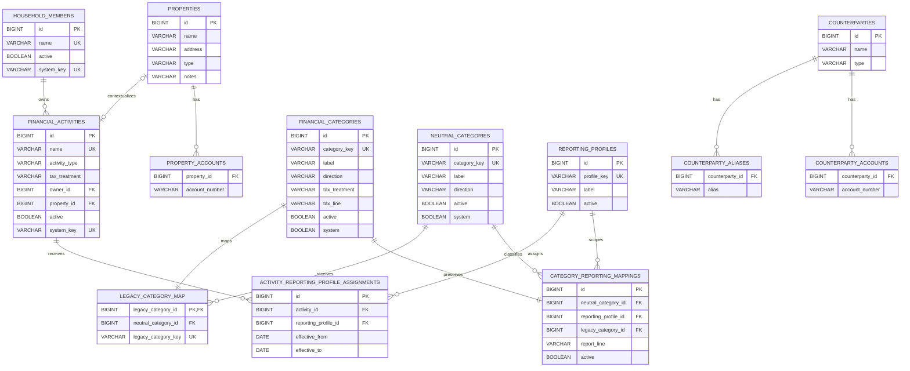
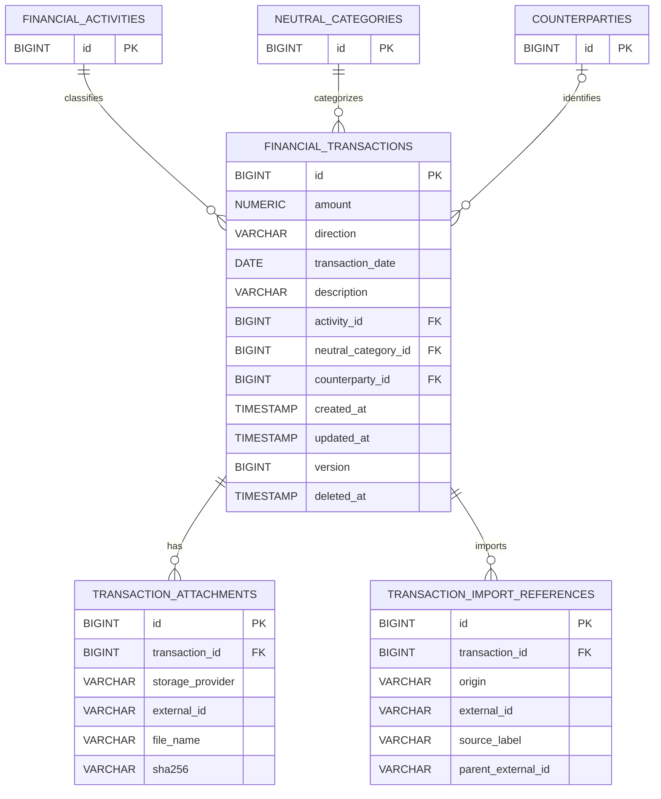
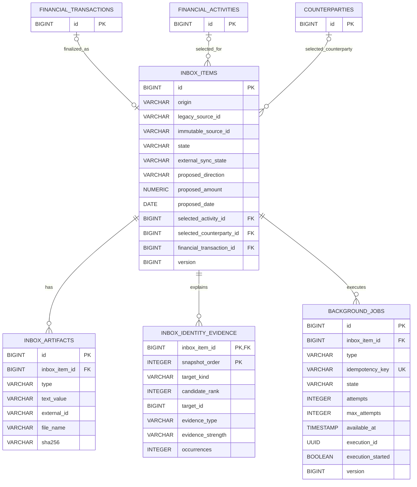

# Bookie Entity-Relationship Diagrams

The schema is split into bounded views so the Mermaid diagrams remain readable. These diagrams show
application-owned tables and their important columns and relationships as of Flyway V21 (V20 retired the legacy expense, income, pending and payer-mirror tables). Generated
PNG previews are included for Markdown viewers that do not execute Mermaid. JobRunr's vendor-owned
tables are summarized separately because they have no foreign keys into Bookie's business schema.

## Catalog and Report Policy

Mermaid source

V20 renamed `payers`, `payer_aliases` and `payer_accounts` to `counterparties`,
`counterparty_aliases` and `counterparty_accounts` (column `payer_id` → `counterparty_id`) after
dropping the V12 mirror, so counterparty IDs and native identity generation are unchanged.
`financial_categories` is retained: report mappings, classification history and inbox proposals
still reference it.

## Unified Ledger

Mermaid source

`financial_transactions` is the only financial record table. Deletes tombstone the row
(`deleted_at`). Historically, V13 copied the legacy `incomes` and `expenses` rows into it through
`legacy_transaction_map`; V20 verified exact parity and dropped all three.

## Durable Intake

Mermaid source

`inbox_items` is the only intake table. Its retained `legacy_*` and confirmation ID columns keep
their historical names but are not foreign keys; `selected_counterparty_id` references
`counterparties`. Historically, V14 copied the legacy pending tables into it through
`legacy_inbox_map`; V20 verified parity and dropped them with their identity-evidence and alias
tables.

`background_jobs.execution_id` is a logical UUID binding to JobRunr's `jobrunr_jobs.id`; vendor
retention may remove the engine row, so no foreign key exists. JobRunr also owns
`jobrunr_migrations`, `jobrunr_recurring_jobs`, `jobrunr_backgroundjobservers`, and
`jobrunr_metadata`.

V21 adds `EVENT_PUBLICATION` (`id` UUID PK, `listener_id`, `event_type`, `serialized_event`,
`publication_date`, `completion_date`), the Spring Modulith event publication registry for the
intake kickoff events and the receipt-filing event. It has no foreign keys: rows reference events
by serialized payload, are deleted on completion, and are excluded from restore reconciliation.

## Classification and Integration Settings

```mermaid
erDiagram
  PROPERTIES {
    BIGINT id PK
  }

  COUNTERPARTIES {
    BIGINT id PK
  }

  FINANCIAL_ACTIVITIES {
    BIGINT id PK
  }

  FINANCIAL_CATEGORIES {
    BIGINT id PK
  }

  OUTLOOK_SETTINGS {
    BIGINT id PK
    VARCHAR receipts_folder_base
    BOOLEAN auto_move_enabled
    VARCHAR move_destination_folder_id
  }

  OUTLOOK_SETTINGS_FOLDER {
    BIGINT settings_id FK
    VARCHAR folder_id
    BOOLEAN expand_subfolders
    BIGINT activity_id FK
  }

  OUTLOOK_SETTINGS_RECEIPTS_IMPORT_FOLDER {
    BIGINT settings_id FK
    VARCHAR folder_path
  }

  OUTLOOK_TOKENS {
    BIGINT id PK
    VARCHAR cache_data
  }

  RECEIPT_HASHES {
    BIGINT id PK
    VARCHAR drive_item_id
    VARCHAR sha256 UK
    TIMESTAMP uploaded_at
  }

  EMAIL_KEYWORD_CLASSIFICATION_HISTORY {
    BIGINT id PK
    VARCHAR keyword
    BIGINT activity_id FK
    BIGINT financial_category_id FK
    INTEGER occurrences
    BIGINT version
  }

  PAYER_PROPERTY_HISTORY {
    BIGINT id PK
    BIGINT payer_id FK
    BIGINT property_id FK
    INTEGER occurrences
  }

  EMAIL_KEYWORD_PROPERTY_HISTORY {
    BIGINT id PK
    VARCHAR keyword
    BIGINT property_id FK
    INTEGER occurrences
  }

  EMAIL_KEYWORD_PAYER_HISTORY {
    BIGINT id PK
    VARCHAR keyword
    BIGINT payer_id FK
    INTEGER occurrences
  }

  OUTLOOK_SETTINGS ||--o{ OUTLOOK_SETTINGS_FOLDER : watches
  OUTLOOK_SETTINGS ||--o{ OUTLOOK_SETTINGS_RECEIPTS_IMPORT_FOLDER : scans
  FINANCIAL_ACTIVITIES o|--o{ OUTLOOK_SETTINGS_FOLDER : configures
  FINANCIAL_ACTIVITIES ||--o{ EMAIL_KEYWORD_CLASSIFICATION_HISTORY : learned_for
  FINANCIAL_CATEGORIES ||--o{ EMAIL_KEYWORD_CLASSIFICATION_HISTORY : categorizes
  COUNTERPARTIES ||--o{ PAYER_PROPERTY_HISTORY : associates
  PROPERTIES ||--o{ PAYER_PROPERTY_HISTORY : associates
  PROPERTIES ||--o{ EMAIL_KEYWORD_PROPERTY_HISTORY : inferred_from
  COUNTERPARTIES ||--o{ EMAIL_KEYWORD_PAYER_HISTORY : inferred_from
```

Mermaid source

The history tables keep their `payer_*` table and column names, but their foreign keys follow the
renamed `counterparties` table. The remaining category-history tables follow the same
occurrence-count pattern and are reached only through `ClassificationHistory`. `outlook_tokens` and `receipt_hashes`
stand alone because their identities belong to external systems rather than another local table.
