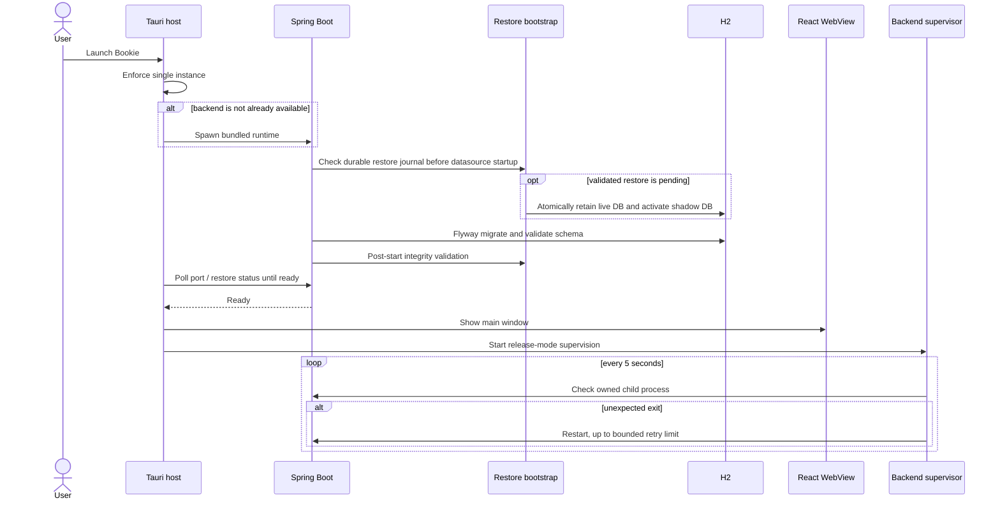
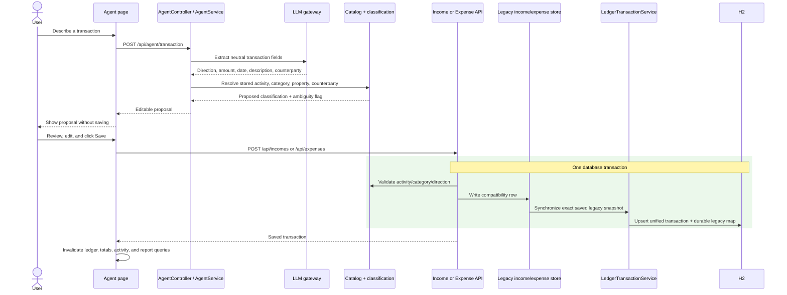
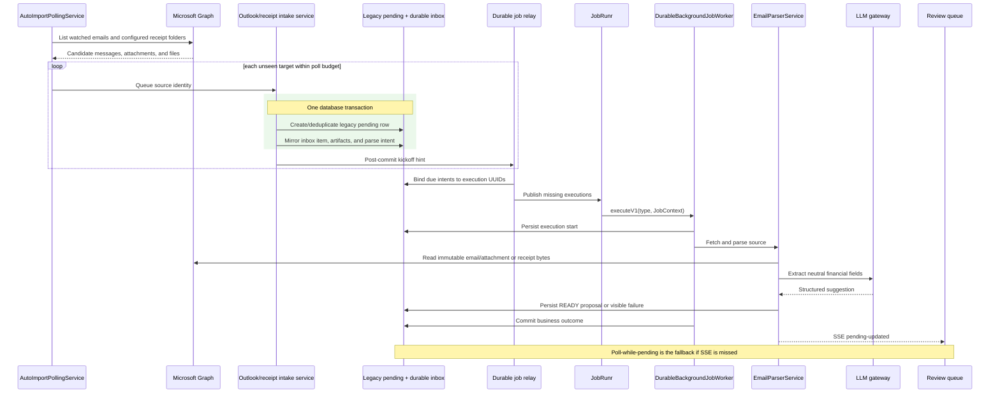
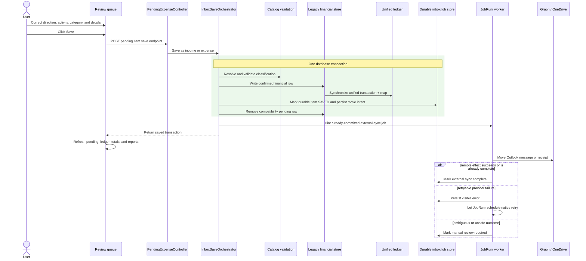
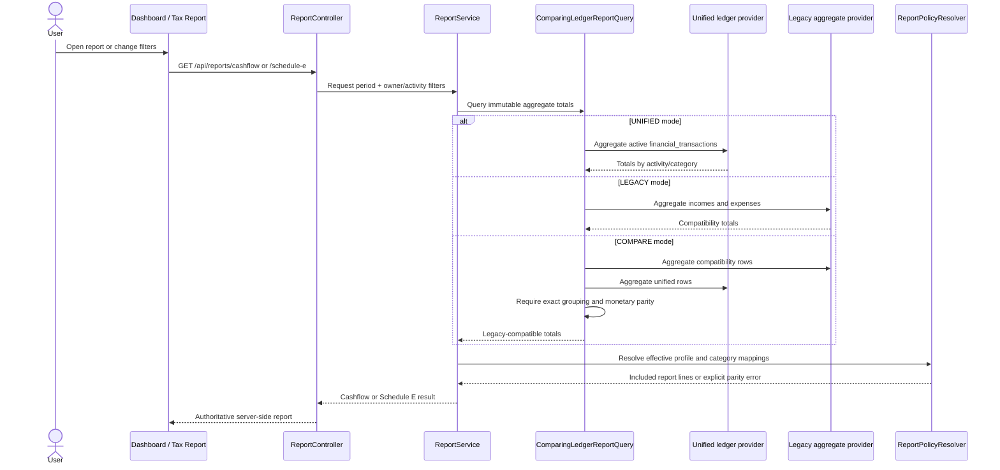
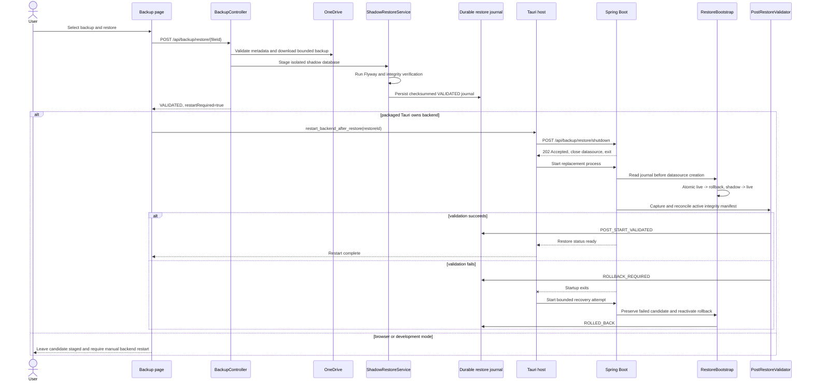

# Bookie Major Flow Sequence Diagrams

These Mermaid sequence diagrams cover the system's major end-to-end flows. Generated PNG previews
are included for Markdown viewers that do not execute Mermaid. The diagrams emphasize transaction
boundaries, explicit user confirmation, compatibility writes, asynchronous execution, and
failure-safe restore behavior.

## Desktop Startup and Supervision

Mermaid source

## AI Proposal and Explicit Save

Mermaid source

## Automated Intake Discovery and Parsing

Mermaid source

## Review Queue Save and External Synchronization

Mermaid source

## Reporting

Mermaid source

## Backup Restore

Mermaid source

