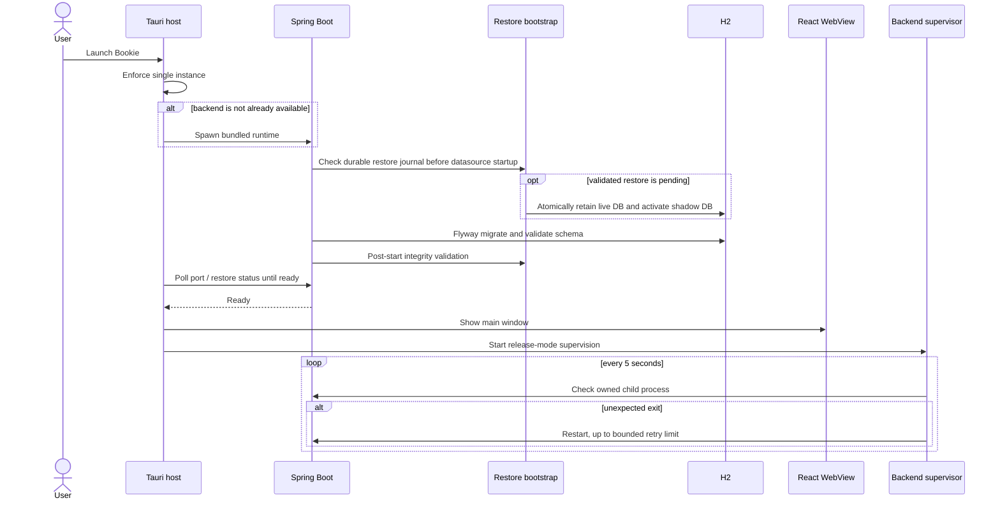
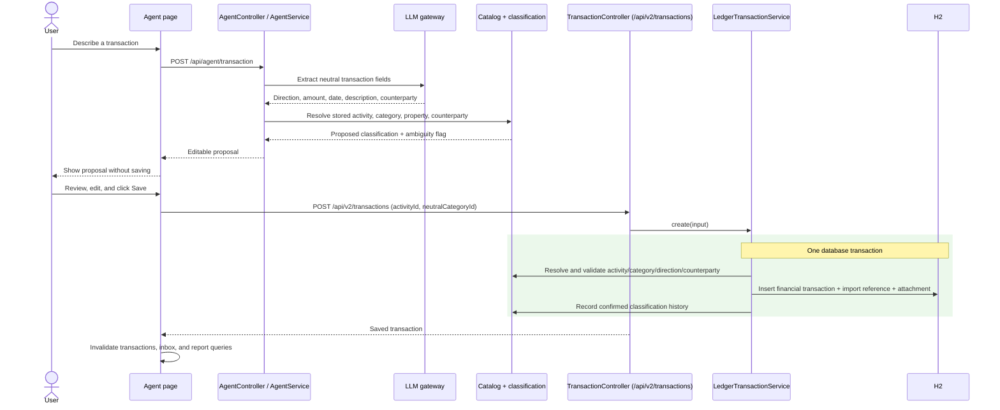
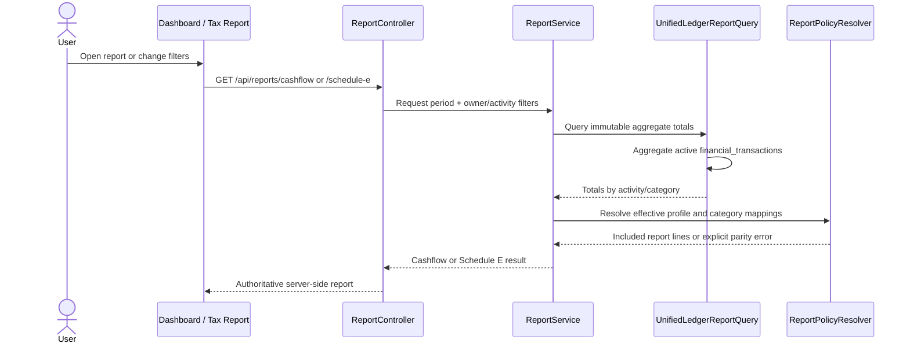
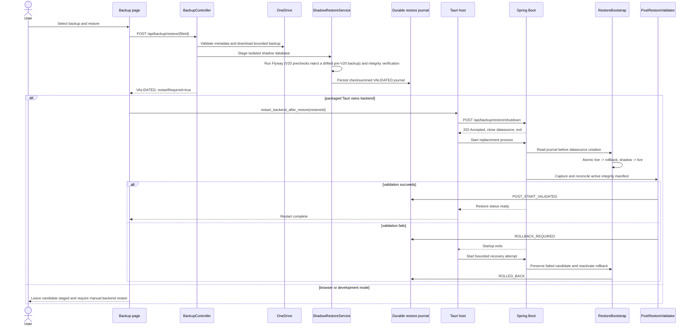

# Bookie Major Flow Sequence Diagrams

These Mermaid sequence diagrams cover the system's major end-to-end flows. Generated PNG previews
are included for Markdown viewers that do not execute Mermaid. The diagrams emphasize transaction
boundaries, explicit user confirmation, asynchronous execution, and failure-safe restore behavior.
The PNG previews may lag the Mermaid source; the source is authoritative.

## Desktop Startup and Supervision


<details>
<summary>Mermaid source</summary>



</details>

## AI Proposal and Explicit Save


<details>
<summary>Mermaid source</summary>



</details>

## Automated Intake Discovery and Parsing


<details>
<summary>Mermaid source</summary>

```mermaid
sequenceDiagram
  participant Poller as AutoImportPollingService
  participant Graph as Microsoft Graph
  participant Intake as Outlook/receipt intake service
  participant DB as Durable inbox
  participant Relay as Durable job relay
  participant JobRunr
  participant Worker as DurableBackgroundJobWorker
  participant Parser as EmailParserService
  participant LLM as LLM gateway
  participant UI as Review queue

  Poller->>Graph: List watched emails and configured receipt folders
  Graph-->>Poller: Candidate messages, attachments, and files
  loop each unseen target within poll budget
    Poller->>Intake: Queue source identity
    rect rgb(235, 248, 235)
      Note over Intake,DB: One database transaction
      Intake->>DB: Create or reuse inbox item by (origin, source id)
      Intake->>DB: Persist artifacts and parse intent
      Intake->>DB: Record InboxItemQueued in EVENT_PUBLICATION
    end
    Intake->>Relay: Post-commit kickoff hint (async listener; may be lost)
  end

  Relay->>DB: Bind due intents to execution UUIDs
  Relay->>JobRunr: Publish missing executions
  JobRunr->>Worker: executeV1(type, JobContext)
  Worker->>DB: Persist execution start
  Worker->>Parser: Fetch and parse source
  Parser->>Graph: Read immutable email/attachment or receipt bytes
  Parser->>LLM: Extract neutral financial fields
  LLM-->>Parser: Structured suggestion
  Parser->>DB: Persist READY proposal or visible failure
  Worker->>DB: Commit business outcome
  Parser-->>UI: SSE inbox-updated (/api/v2/inbox/events)
  Note over UI,DB: Poll-while-transient is the fallback if SSE is missed
```

</details>

## Review Queue Save and External Synchronization


<details>
<summary>Mermaid source</summary>

```mermaid
sequenceDiagram
  actor User
  participant UI as Review queue
  participant Controller as InboxController
  participant Save as InboxCommandService
  participant Ledger as LedgerTransactionService
  participant Inbox as Durable inbox/job store
  participant Worker as JobRunr worker
  participant Graph as Graph / OneDrive

  User->>UI: Correct direction, activity, category, and details
  User->>UI: Click Save
  UI->>Controller: POST /api/v2/inbox/{id}/save
  Controller->>Save: save(id, command)
  rect rgb(235, 248, 235)
    Note over Save,Inbox: One database transaction
    Save->>Ledger: createFromInbox (validate, insert transaction; never files a receipt)
    Save->>Inbox: Mark item SAVED and persist MOVE_OUTLOOK / MOVE_RECEIPT intent
    Save->>Inbox: Record InboxItemSaved in EVENT_PUBLICATION
  end
  Save-->>Worker: After commit, the async kickoff listener hints the committed job
  Save-->>UI: Return saved inbox item
  UI->>UI: Refresh inbox, transactions, and reports

  Worker->>Graph: Move Outlook message or receipt
  alt remote effect succeeds or is already complete
    Worker->>Inbox: Mark external sync complete
  else retryable provider failure
    Worker->>Inbox: Persist visible error
    Worker-->>Worker: Let JobRunr schedule native retry
  else ambiguous or unsafe outcome
    Worker->>Inbox: Mark manual review required
  end
```

</details>

## Manual Receipt Filing

<details>
<summary>Mermaid source</summary>

```mermaid
sequenceDiagram
  actor User
  participant UI as Transaction form
  participant API as TransactionController
  participant Ledger as LedgerTransactionService
  participant Registry as EVENT_PUBLICATION registry
  participant Filing as ReceiptFilingListener (intake)
  participant Resubmitter as EventPublicationResubmitter
  participant OneDrive

  User->>UI: Save an expense with origin RECEIPT and an attachment
  UI->>API: POST /api/v2/transactions
  API->>Ledger: create(input)
  rect rgb(235, 248, 235)
    Note over Ledger,Registry: One database transaction
    Ledger->>Ledger: Insert transaction + attachment, record classification
    Ledger->>Registry: Publish TransactionRecorded (incomplete publication)
  end
  API-->>UI: Saved transaction (receipt may not be filed yet)
  Registry-->>Filing: After commit, asynchronously, no wrapping transaction
  Filing->>OneDrive: Move file into the tax-year folder (idempotent)
  alt move succeeds
    Filing->>Registry: Complete (publication deleted)
  else move fails
    Filing-->>Registry: Throw; publication stays incomplete
    loop after Ready, while incomplete and older than 5 minutes
      Resubmitter->>Filing: Resubmit TransactionRecorded
      Filing->>OneDrive: Retry the move
    end
  end
```

</details>

Only the manual create path publishes `TransactionRecorded`; a rolled-back create records and files
nothing. An inbox receipt save records the transaction without the event; its durable
`MOVE_RECEIPT` job moves the file after commit (see above).

## Reporting


<details>
<summary>Mermaid source</summary>



</details>

## Backup Restore


<details>
<summary>Mermaid source</summary>



</details>
